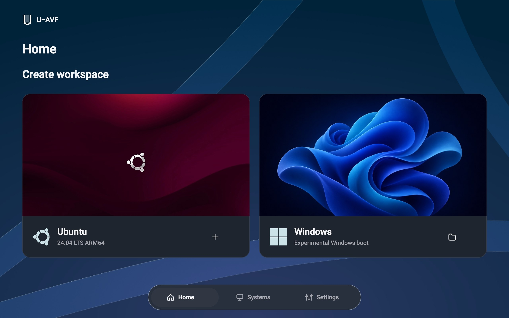
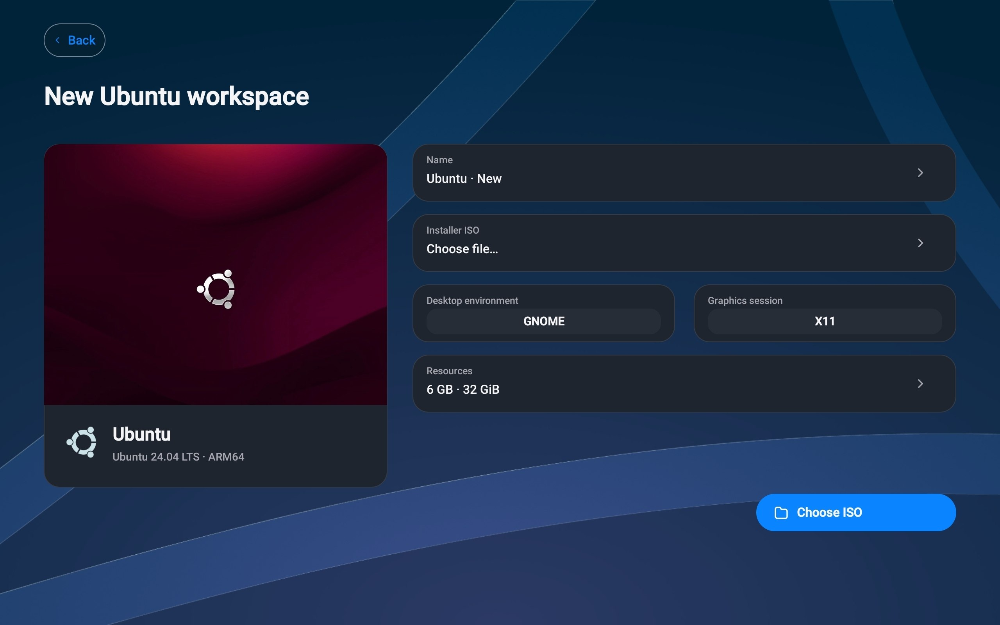
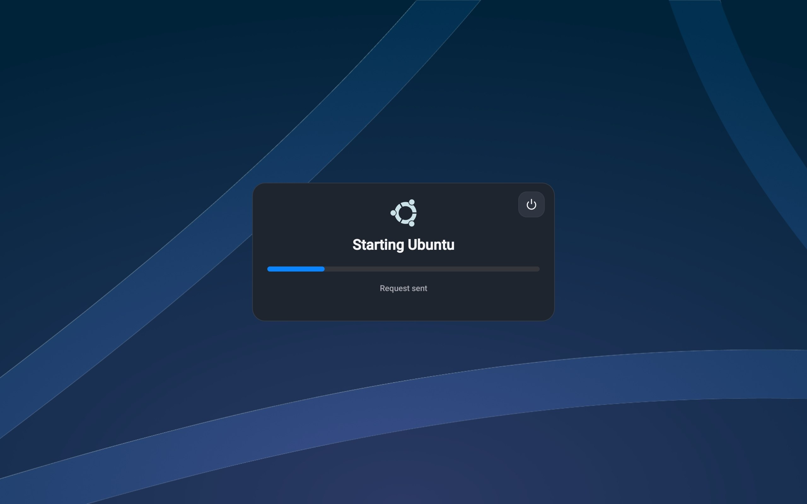
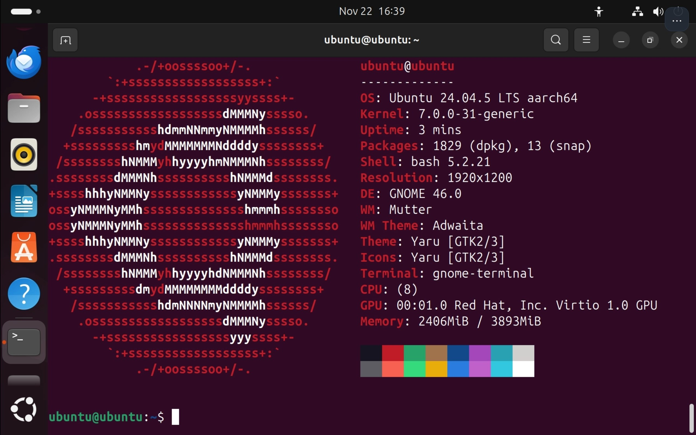
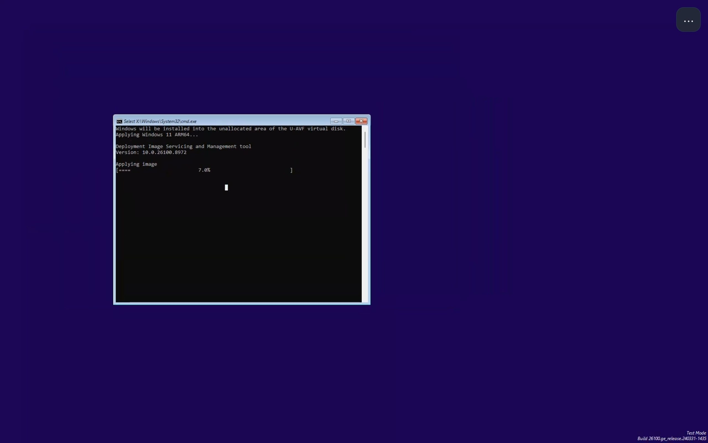
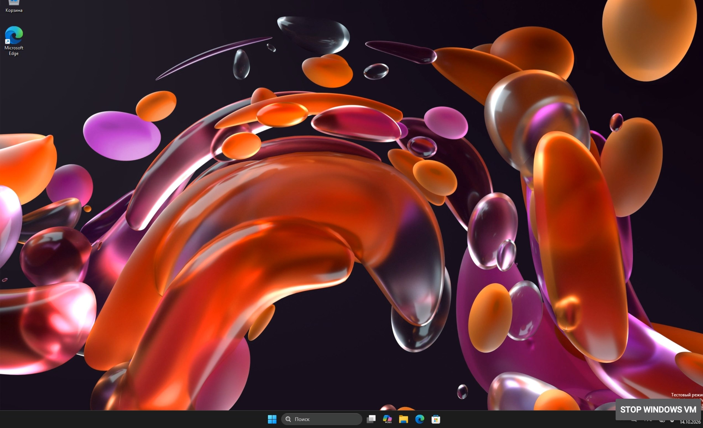
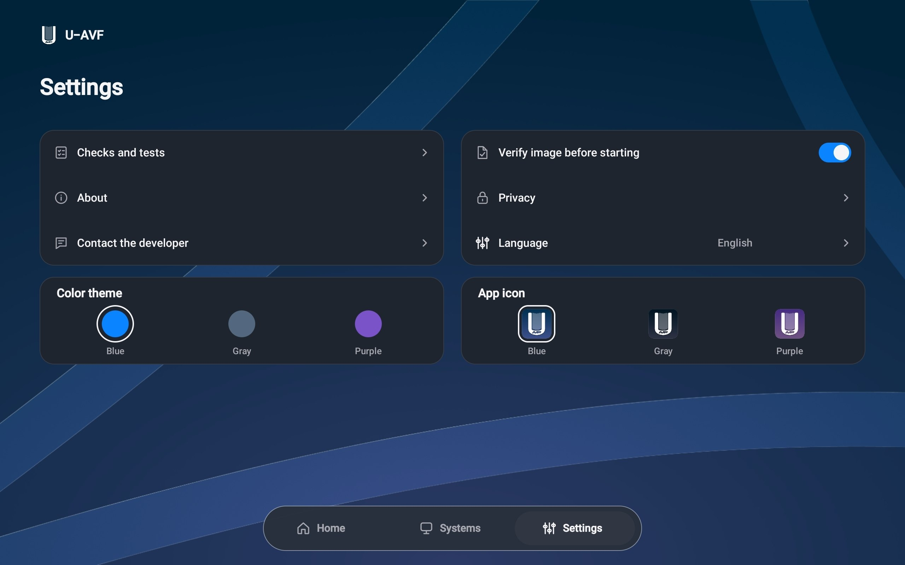

# U-AVF 1.2

[English](#english) · [Русский](#русский) · [Releases](https://github.com/dt0-imsyu/U-AVF/releases)

## English



U-AVF runs **Ubuntu Desktop** and **Windows 11 ARM64 (experimental)** on Android tablets without root, using the Android Virtualization Framework (AVF).

U-AVF is optimized for **MediaTek chipsets** and is developed and tested on the **Samsung Galaxy Tab S11 (One UI 8.5)**. It may also work on other ARM64 devices with **Mali graphics**, including some Google Tensor devices, but compatibility is not guaranteed. You can install both Ubuntu and Windows, although only one virtual machine can run at a time.

### Getting started

1. Download the APK from [Releases](https://github.com/dt0-imsyu/U-AVF/releases). You need **Android 16 or later**, an ARM64 processor, and support for custom AVF virtual machines.
2. Enable **USB debugging** and connect your tablet to a computer with [Android Platform Tools](https://developer.android.com/tools/releases/platform-tools). Run:

   ```sh
   adb devices
   adb shell pm grant com.example.winavf android.permission.MANAGE_VIRTUAL_MACHINE
   adb shell pm grant com.example.winavf android.permission.USE_CUSTOM_VIRTUAL_MACHINE
   ```

U-AVF **automatically checks compatibility** on first launch. If the check fails, your device may not support the required features.

The check runs on your device. Sending a diagnostic report is optional and requires your consent. Reports help us expand support to other devices, so we'd appreciate your test results.

See the [privacy policy](docs/release-preparation/PRIVACY.md) for details.

### Ubuntu Desktop

1. Download the official [Ubuntu 24.04.5 Desktop ARM64 ISO](https://cdimage.ubuntu.com/ubuntu/releases/24.04/release/).
2. In U-AVF, go to **Systems → Create workspace → Ubuntu**. Select the ISO and choose a disk size.
3. Choose a graphics profile, install Ubuntu, and restart the virtual machine. You can then launch Ubuntu from its workspace.







Depending on your configuration, up to three graphics profiles may be available:

- **GNOME X11 · VirGL / H.264** — the recommended default.
- **GNOME X11 · Mavk** — experimental graphics mode.
- **KDE Plasma X11 · Mavk** — experimental; an internet connection is needed to download KDE packages during installation.

To try Ubuntu without installing it, go to **Systems → Temporary live session**. You can configure CPU and memory separately for the live session.

### Windows 11 ARM64

**Windows currently runs at a low frame rate (around 10–15 FPS).**

Audio output isn't available yet. Display output is still unstable: even changing the display scaling in Windows can cause the picture to disappear. An update to improve FPS and add sound is currently in development.

1. Download a Windows 11 ARM64 ISO from [Microsoft](https://www.microsoft.com/en-us/software-download/windows11arm64).
2. In U-AVF, go to **Systems → Create workspace → Windows**, select the ISO, and choose **Automatic installation**.
3. Follow the on-screen instructions. Once installed, you can start Windows from its workspace.

Tested ISOs: **Windows 11 ARM64 26H2 (English)** and **25H2 (Russian, build 26200.6584)**. Automatic installation may not work with other images.





### Other features

U-AVF supports touch, mouse and keyboard input, optional capture of system keyboard shortcuts (such as the Command or Windows key on an external keyboard), and guest configuration options where available. You can also search, copy and export diagnostic logs.

The interface is available in English, Russian, Spanish, German, Simplified Chinese and Japanese.



### Known issues

- **Ubuntu installation:** The installer can become noticeably slow when its window is maximized. This is an installer issue; the regular desktop works normally after installation.
- **Mavk:** Both profiles are experimental. Many applications may fail to open or encounter errors.
- **Ubuntu App Center:** The store may display incorrectly or behave inconsistently because of graphics issues, but it can still install applications.

### Building from source

See [android-app/README.md](android-app/README.md) for build instructions and requirements. Release builds need a compatible base APK; this is not a standard one-command Android build.

**Be careful with custom builds.** Uninstalling U-AVF or clearing its app data may delete your virtual disks. We recommend installing custom builds as a separate app, with a different application ID, instead of updating the release version in place.

[Licenses](LICENSE) · [License scope](LICENSE_SCOPE.md) · [Third-party components](docs/release-preparation/THIRD_PARTY_COMPLIANCE.md) · [Report a bug](https://github.com/dt0-imsyu/U-AVF/issues)

[↑ English](#english) · [Русский](#русский)

---

## Русский


U-AVF запускает **Ubuntu Desktop** и **Windows 11 ARM64 (экспериментально)** на Android-планшете без root. Для этого используется Android Virtualization Framework (AVF).

U-AVF оптимизирован под **процессоры MediaTek** и разрабатывается и тестируется на **Samsung Galaxy Tab S11 (One UI 8.5)**. Он также может работать на других ARM64-устройствах с **графикой Mali**, включая некоторые устройства на Google Tensor, но совместимость не гарантируется. Ubuntu и Windows можно установить одновременно, но запускать — только по одной виртуальной машине.

### Первый запуск

1. Скачайте APK из раздела [Releases](https://github.com/dt0-imsyu/U-AVF/releases). Нужны **Android 16 или новее**, процессор ARM64 и поддержка пользовательских виртуальных машин AVF.
2. Включите **отладку по USB** и подключите планшет к компьютеру с [Android Platform Tools](https://developer.android.com/tools/releases/platform-tools). Выполните команды:

   ```sh
   adb devices
   adb shell pm grant com.example.winavf android.permission.MANAGE_VIRTUAL_MACHINE
   adb shell pm grant com.example.winavf android.permission.USE_CUSTOM_VIRTUAL_MACHINE
   ```

После первого запуска U-AVF **автоматически проверит совместимость**. Если проверка не пройдена, устройство может не поддерживать нужные функции.

Проверка проходит на самом устройстве. Отправка диагностического отчёта необязательна и возможна только с вашего согласия. Отчёты помогают расширять поддержку других устройств, поэтому мы будем благодарны за ваши тесты.

Подробнее — в [политике конфиденциальности](docs/release-preparation/PRIVACY.md).

### Ubuntu Desktop

1. Скачайте официальный [ISO Ubuntu 24.04.5 Desktop ARM64](https://cdimage.ubuntu.com/ubuntu/releases/24.04/release/).
2. Откройте в U-AVF **Системы → Создать воркспейс → Ubuntu**. Выберите ISO и размер диска.
3. Выберите профиль графики, пройдите установку Ubuntu и перезапустите виртуальную машину. После этого Ubuntu можно запускать из своего воркспейса.


В зависимости от выбранных параметров могут предлагаться три профиля:

- **GNOME X11 · VirGL / H.264** — основной, рекомендуемый вариант.
- **GNOME X11 · Mavk** — экспериментальный режим графики.
- **KDE Plasma X11 · Mavk** — экспериментальный вариант; для загрузки пакетов KDE во время установки нужен интернет.

Если хотите сначала попробовать Ubuntu без установки, откройте **Системы → Временная Live-сессия**. Для неё отдельно настраиваются процессор и память.

### Windows 11 ARM64

**Windows пока работает с низкой частотой кадров (около 10–15 FPS).**

Вывода звука пока нет. Вывод изображения пока нестабилен: даже изменение масштаба в настройках Windows может привести к пропаданию картинки. Сейчас идёт работа над обновлением Windows-режима, которое должно повысить FPS и добавить звук.

1. Скачайте ISO Windows 11 ARM64 с [сайта Microsoft](https://www.microsoft.com/en-us/software-download/windows11arm64).
2. В U-AVF откройте **Системы → Создать воркспейс → Windows**, выберите ISO и нажмите **Автоматическая установка**.
3. Следуйте инструкциям на экране. После установки Windows можно будет запускать из её воркспейса.

Проверенные ISO: **Windows 11 ARM64 26H2 (английский)** и **25H2 (русский, сборка 26200.6584)**. Другие образы могут не поддерживать автоматическую установку.


### Другие возможности

Поддерживаются сенсорный ввод, мышь и клавиатура, дополнительный перехват системных сочетаний клавиш (например, Command или Windows на внешней клавиатуре) и изменение конфигурации гостевой системы, где это возможно. Нужные логи можно искать, копировать и экспортировать.

Интерфейс доступен на русском, английском, испанском, немецком, упрощённом китайском и японском.


### Известные проблемы

- **Установка Ubuntu:** Окно установщика заметно тормозит при разворачивании на весь экран. Это проблема установщика; после установки обычный рабочий стол работает нормально.
- **Mavk:** Оба профиля экспериментальные. Многие приложения могут не открываться или работать с ошибками.
- **Магазин приложений Ubuntu:** Иногда отображается некорректно или нестабильно из-за особенностей вывода изображения, но приложения устанавливает.

### Сборка из исходников

Инструкция и зависимости находятся в [android-app/README.md](android-app/README.md). Для релизной сборки требуется совместимый базовый APK; обычной одной команды сборки Android-проекта недостаточно.

**Будьте аккуратны с собственными сборками.** Удаление U-AVF или очистка данных приложения могут удалить виртуальные диски. Рекомендуем устанавливать свои сборки как отдельное приложение с другим идентификатором пакета, а не поверх релизной версии.

[Лицензии](LICENSE) · [Подробности лицензирования](LICENSE_SCOPE.md) · [Сторонние компоненты](docs/release-preparation/THIRD_PARTY_COMPLIANCE.md) · [Сообщить об ошибке](https://github.com/dt0-imsyu/U-AVF/issues)

[English](#english) · [↑ Русский](#русский)
